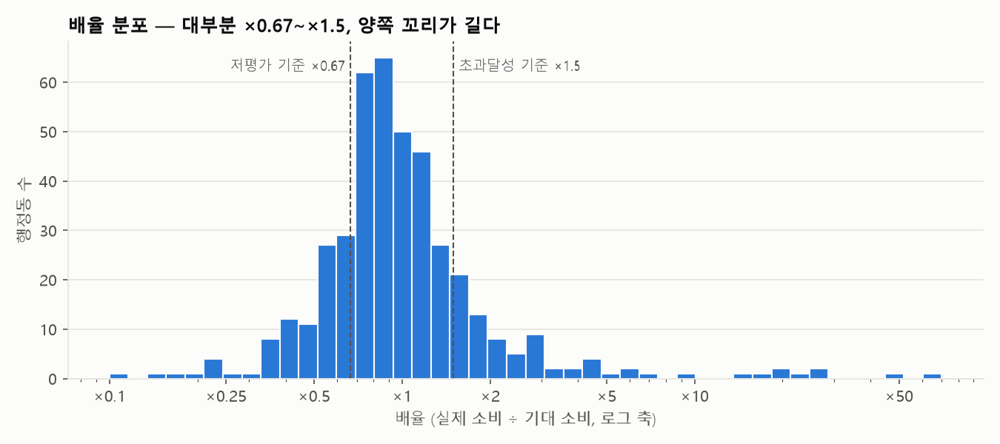
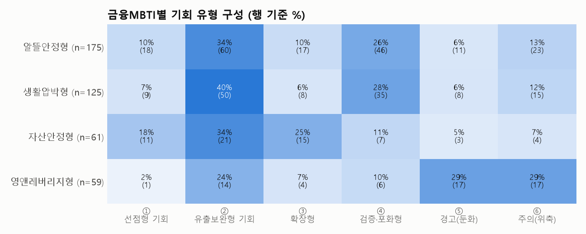
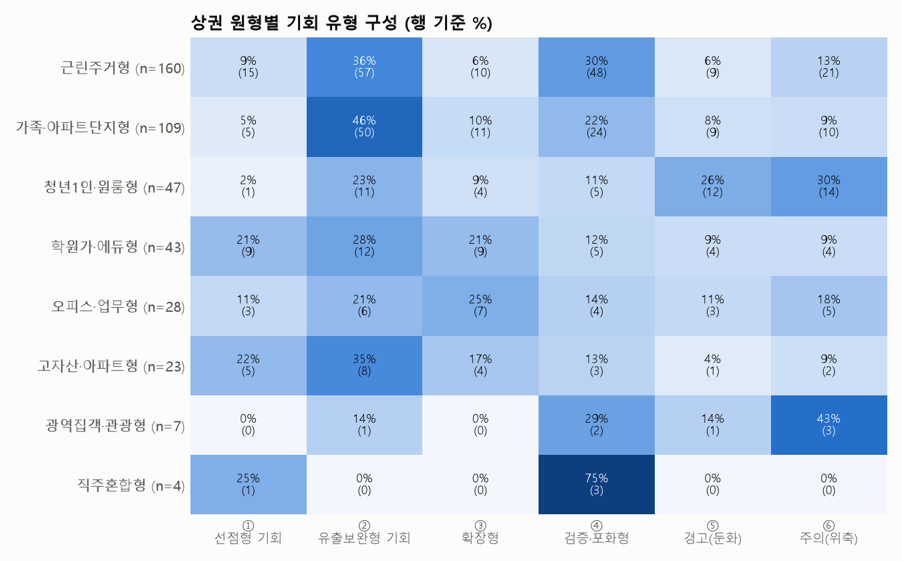
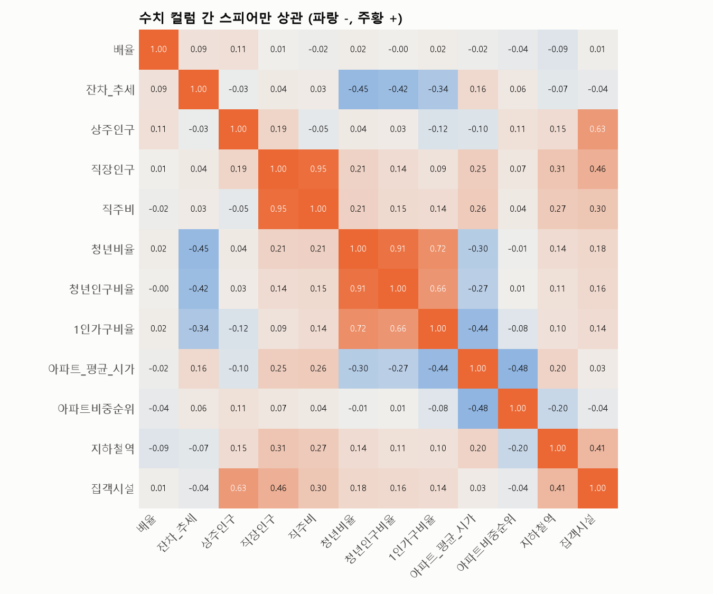
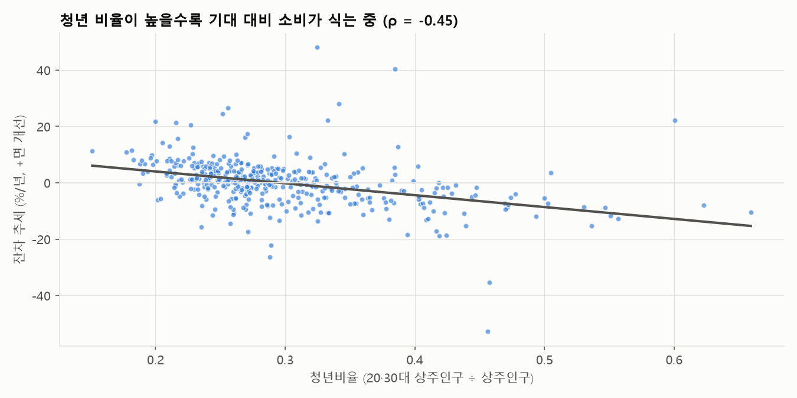

# 서울시 행정동별 상권분석 통합 데이터셋 — 가이드 & 기본 EDA

| 항목 | 내용 |
|---|---|
| 파일 | `data/processed/서울시_행정동별_상권분석_통합.csv` (UTF-8 BOM) |
| 크기 | **425행 × 43열** — 1행 = 1개 행정동 (서울 25개 자치구 전체) |
| 기준 시점 | 수치 지표 2025년 평균 · 추세 2023Q1–2025Q4 · 금융MBTI 2025Q4 |
| 기본키 | `행정동_코드` (8자리, 유일) |
| 생성 | `scripts/merge_commercial_datasets.py` (통합) · `scripts/eda_commercial_merged.py` (이 문서의 차트) |
| 원천 | Gemi_pjt 상권분석 키워드(423동, 정성) + Clau_pjt 상권기회 인사이트(425동, 모델·정량) |

---

## Part 1. 데이터셋 가이드

### 1-1. 한눈에 보기

이 데이터셋은 한 동네를 세 가지 눈으로 봅니다.

| 관점 | 무엇을 알려주나 | 대표 컬럼 |
|---|---|---|
| **누가 사는가** (금융MBTI) | 주민의 소득·자산·소비·연체 성향 | `금융MBTI`, `1인가구비율`, `아파트_평균_시가` |
| **어떤 상권인가** (정성 키워드) | 아파트위키 기반 입지·장단점·추천 업종 | `상권_유형`, `상권_장점_키워드`, `추천_유망_업종` |
| **돈이 기대만큼 쓰이는가** (모델) | 인구·인프라로 예측한 기대 소비 대비 실제 소비, 그 추세 | `배율`, `잔차_추세`, `기회_유형`, `업종_공백` |

### 1-2. 컬럼 사전 (43개)

**① 행정동 기준 (3)**

| 컬럼 | 타입 | 설명 | 예시 |
|---|---|---|---|
| 자치구 | 문자 | 25개 자치구 | 강남구 |
| 행정동_코드 | 정수 | 8자리 행정동 코드 — **조인 키** | 11680610 |
| 행정동_코드_명 | 문자 | 행정동명 (`신사동`은 강남·관악 2곳 → 이름으로 조인 금지) | 대치2동 |

**② 금융MBTI (2)** — 출처: 키워드 파일

| 컬럼 | 타입 | 설명 | 예시 |
|---|---|---|---|
| 금융MBTI | 문자 | 주민 금융 성향 4종 (KMeans k=4) | 자산안정형 |
| 군집 | 정수 | 0 영앤레버리지형 · 1 생활압박형 · 2 자산안정형 · 3 알뜰안정형 | 2 |

**③ 상권 프로파일 (3)**

| 컬럼 | 타입 | 설명 | 예시 |
|---|---|---|---|
| 대표_아파트_단지 | 문자 | apt.wiki 기준 핵심 단지 (`-` = 없음) | 은마, 래미안대치팰리스 |
| 상권_유형 | 문자 | 정성 상권 유형 **51종** (키워드 파일) | 학원·에듀타운형 |
| 상권_원형 | 문자 | 수치 기반 상권 원형 **8종** (인사이트 파일) | 학원가·에듀형 |

**④ 핵심 키워드 — 정성 서술 (4)** — 출처: 키워드 파일

| 컬럼 | 설명 | 예시 (대치2동) |
|---|---|---|
| 접근성_교통_키워드 | 역세권·지형·환승·도로망 | 3호선 대치역·한티역 역세권, 밤 10시 학원가 일대 왕복 차선 마비 |
| 상권_장점_키워드 | 인프라·배후수요 강점 | 전국 1위 학원가 밀집으로 10대 학생 및 학부모 유동인구 365일 극대화 … |
| 상권_단점_리스크_키워드 | 소음·공실·주차난 등 | 야간 픽업 차량으로 인한 극심한 교통정체, 주차난 심각 … |
| 주요_배후수요_특성 | 핵심 거주·유동 페르소나 | 초·중·고 수험생 자녀를 둔 4050 학부모 및 강사진 |

**⑤ 키워드 태그 — 3축 해시태그 (3)** — 출처: 인사이트 파일. 공백으로 구분, 빈 칸 = 해당 태그 없음

| 컬럼 | 설명 | 예시 (대치2동) |
|---|---|---|
| 키워드_접근성인프라 | 역세권·집객시설·몰세권·지형 등 | #다중역세권 #집객시설밀집 #주차난 |
| 키워드_소비배후수요 | 자산·청년·직장인·가족·야간/주말 등 | #초고자산 #직장인밀집 #학원가·학군 |
| 키워드_환경리스크 | 공실·소음·정체·유출·위축 등 | #교통정체 #노후상권 #고임대료 #주말공동화 #소비유출 |

태그 기준은 `Clau_pjt/report/상권기회_인사이트_보고서.md` 1장 참고.

**⑥ 업종 인사이트 (6)**

| 컬럼 | 출처 | 설명 |
|---|---|---|
| 추천_유망_업종 | 키워드 | 정성 추천 업종 |
| 비추천_주의_업종 | 키워드 | 입점 리스크 업종 |
| 타깃_업종 | 인사이트 | `[데이터]` 업종 공백 기반 추천 + `[현장키워드]` 정성 추천 병기 |
| 업종_공백 | 인사이트 | 같은 원형 동 중앙값 대비 지출 비중 ×0.75 이하 업종 (최대 2개). 빈 칸 = 공백 없음 |
| 업종_강점 | 인사이트 | 같은 원형 동 중앙값 대비 ×1.35 이상 업종 (최대 2개). 빈 칸 = 강점 없음 |
| 상권_한줄평 | 키워드 | 상권 종합 요약 |

**⑦ 상권 기회 — 모델 결과 (10)** — 출처: 인사이트 파일

| 컬럼 | 타입 | 설명 |
|---|---|---|
| 유형 | 문자 | 초과달성(기대 ×1.5↑) · 기대수준 · 저평가(×0.67↓) · 데이터점검 |
| 사분면 | 문자 | 수준 × 추세 6분면 + 데이터점검 |
| 기회_유형 | 문자 | ① 선점형 · ② 유출보완형 · ③ 확장형 · ④ 검증·포화형 · ⑤ 경고(둔화) · ⑥ 주의(위축) |
| 기회점수 | 실수 | 0–100. **①·②만 산정**, 나머지 빈 칸 |
| 기회순위 | 실수 | 기회점수 순위 (1 = 최고). ①·②만 |
| 배율 | 실수 | 실제 소비 ÷ 기대 소비 (×1 = 기대 수준) |
| 격차금액_분기 | 실수(원) | 실제 − 기대, 분기 평균 |
| 잔차_추세 | 실수 | 연간 격차 변화 (0.05 = 연 5%p 개선) |
| 기회_인사이트 | 문자 | 동별 자동 생성 요약 문장 |
| 해석주의 | 문자 | 배율 극단(×5↑ 또는 ×0.25↓) 경고. 빈 칸 = 정상 |

**⑧ 정량 지표 (13)**

| 컬럼 | 단위 | 설명 | 출처 |
|---|---|---|---|
| 상주인구 · 직장인구 | 명 | 2025년 분기 평균 | 상권분석서비스 |
| 직주비 | 배 | 직장인구 ÷ 상주인구 | 파생 |
| 청년비율 | 0–1 | 20·30대 상주인구 ÷ 상주인구 | 상권분석서비스 |
| 청년인구비율 | 0–1 | SKT 청년 인구 ÷ SKT 총인구 | SKT 시민생활 |
| 1인가구비율 | 0–1 | SKT 1인가구 ÷ SKT 총인구 | SKT 시민생활 |
| 아파트_평균_시가 | 원 | 동 내 아파트 평균 시가 | 상권분석서비스 |
| 아파트비중순위 | 0–1 | 아파트 세대 비중의 서울 내 백분위 (절대 비율 아님) | 파생 |
| 지하철역 · 집객시설 | 개 | 동 내 시설 수 | 상권분석서비스 |
| 경도 · 위도 | WGS84 | 동 중심 좌표 | 상권분석서비스 영역 |

### 1-3. 결측치 — 빈 칸의 의미

| 빈 칸 원인 | 컬럼 | 행 수 | 처리 권장 |
|---|---|---|---|
| **키워드 파일에 없는 2개 동** (둔촌1동·항동) | 금융MBTI, 군집, 대표_아파트_단지, 상권_유형, 정성 키워드 4개, 추천/비추천 업종, 상권_한줄평, 청년인구비율, 1인가구비율 | 2 | 분석 시 제외하거나 그대로 둠 |
| **설계상 산정 안 함** | 기회점수, 기회순위 | 246 | ①·② 외 유형은 점수 없음 |
| **해당 없음** | 해석주의 | 403 | 빈 칸 = 정상 |
| | 키워드_소비배후수요 · 키워드_환경리스크 | 50 · 50 | 해당 태그 없음 |
| | 업종_공백 · 업종_강점 | 41 · 11 | 두드러진 공백·강점 없음 |
| **원천 결측** | 아파트_평균_시가, 아파트비중순위 | 1 | 둔촌1동 (재건축) |
| **`-` 표기** (결측 아님) | 대표_아파트_단지 | 228 | 대표 단지 미지정 |

### 1-4. 사용 전 꼭 알아야 할 6가지

1. **정성 키워드 컬럼은 `상권_유형`에 100% 종속됩니다.** `대표_아파트_단지`·키워드 4개·추천/비추천 업종은 51개 `상권_유형`마다 한 가지 값뿐입니다. 예: `1인청년·원룸배달형` 68개 동(8개 구)은 문장이 모두 같습니다. **동 단위 차이는 태그(⑤)·업종 공백(⑥)·모델(⑦) 컬럼에서 봐야 합니다.**
2. **`배율`은 로그 스케일로 보세요.** 왜도 9.5, 최대 ×67.5(용산2가동). 평균(1.73)은 의미가 없고 중앙값(0.90)을 쓰세요.
3. **`해석주의` 22개 동은 집계 착시 가능성.** ×5↑(14곳, 용산2가동·구로3동·역삼2동·소공동 등)은 대형점·본사 매출이 주소로 잡혔을 수 있고, ×0.25↓(8곳, 여의동·압구정동·명동 등)는 인접 거대상권 흡수나 재건축 영향일 수 있습니다.
4. **`청년비율` ≠ `청년인구비율`.** 분모가 다릅니다(상주인구 vs SKT 총인구). 상관 ρ = 0.91로 비슷하지만 재건축 지역에서 갈립니다. 인구 비율 분석에는 SKT 기준(`청년인구비율`, `1인가구비율`)을 권장합니다.
5. **`직장인구` ≈ `직주비`** (ρ = 0.95). 모델 입력으로 함께 쓰면 다중공선성. `직주비`는 명동(×50)·반포본동(×48)처럼 상주인구가 작은 동에서 폭증합니다.
6. **`아파트비중순위`는 상대 순위입니다.** 원천 `아파트_가구_수`가 전 기간 0이라 다른 아파트 데이터로 대체했고, 일부 단지만 집계돼 절대값을 쓰지 않았습니다. 고가 지역일수록 낮게 나오는 경향(시가와 ρ = −0.48)이 있어 해석에 주의하세요.

### 1-5. 사용 예시 (pandas)

```python
import pandas as pd
df = pd.read_csv("data/processed/서울시_행정동별_상권분석_통합.csv", encoding="utf-8-sig")

# 1) 신뢰 가능한 동만 (데이터점검·해석주의 제외)
clean = df[(df["기회_유형"] != "데이터점검") & df["해석주의"].isna()]

# 2) 선점형 기회 Top 10
clean[clean["기회_유형"] == "① 선점형 기회"].nsmallest(10, "기회순위")[
    ["자치구", "행정동_코드_명", "상권_원형", "배율", "업종_공백", "타깃_업종"]]

# 3) 태그 검색 — 상가 공실 + 소비 유출이 동시에 있는 동
has = lambda col, tag: df[col].fillna("").str.contains(tag, regex=False)
df[has("키워드_환경리스크", "#상가공실") & has("키워드_환경리스크", "#소비유출")]

# 4) 다른 행정동 데이터와 결합 — 반드시 코드로
# other.merge(df, on="행정동_코드", how="left", validate="one_to_one")
```

---

## Part 2. 기본 EDA

### 2-1. 구조

- **행:** 425 (자치구별 10–27개, 중앙값 16. 최소 금천구 10 · 최대 송파구 27)
- **열:** 문자 24 · 실수 18 · 정수 1
- **중복:** `행정동_코드` 중복 0건. `행정동_코드_명`은 424종(신사동 2곳)

### 2-2. 범주형 분포

| 컬럼 | 분포 |
|---|---|
| **금융MBTI** | 알뜰안정형 175 · 생활압박형 125 · 자산안정형 63 · 영앤레버리지형 60 · (없음 2) |
| **상권_원형** | 근린주거형 161 · 가족·아파트단지형 110 · 청년1인·원룸형 47 · 학원가·에듀형 43 · 오피스·업무형 29 · 고자산·아파트형 24 · 광역집객·관광형 7 · 직주혼합형 4 |
| **유형** | 기대수준 266 · 저평가 89 · 초과달성 66 · 데이터점검 4 |
| **기회_유형** | ② 유출보완형 145 · ④ 검증·포화형 94 · ⑥ 주의(위축) 59 · ③ 확장형 45 · ① 선점형 39 · ⑤ 경고(둔화) 39 · 데이터점검 4 |
| **상권_유형** | 51종. 상위 4종(대단지·생활근린형 97, 1인청년·원룸배달형 68, 서민베드타운·생활근린형 55, 역사도심·관광오피스형 32)이 60%. 51종 중 14종은 동 1–2개짜리 |

**태그 빈도 Top 5**

| 축 | Top 5 |
|---|---|
| 접근성·인프라 | #역세권공백 196 · #주차난 176 · #역세권 133 · #환승요충지 125 · #다중역세권 96 |
| 소비·배후수요 | #2030청년가구 107 · #가성비선호 106 · #야간소비 85 · #주말나들이 85 · #고령층 75 |
| 환경·리스크 | #노후상권 102 · #소비위축추세 99 · #외부유입한계 97 · #소비유출 89 · #주말공동화 69 |

→ 서울 행정동의 **46%는 역세권 밖**이고, 가장 흔한 리스크는 **노후 상권과 소비 위축**입니다.

### 2-3. 수치형 요약

| 컬럼 | 최소 | 25% | 중앙값 | 75% | 최대 | 왜도 |
|---|---|---|---|---|---|---|
| 배율 | ×0.11 | ×0.72 | **×0.90** | ×1.24 | ×67.5 | 9.5 |
| 격차금액_분기 | −1.07조 | −13억 | −3.3억 | +11억 | +1.95조 | 7.9 |
| 잔차_추세 | −2.22 | −0.045 | 0.003 | 0.040 | 2.35 | 1.0 |
| 기회점수 (n=179) | 36.7 | 51.0 | 60.8 | 69.6 | 90.3 | 0.1 |
| 상주인구 | 2,454 | 15,122 | 19,782 | 25,006 | 46,043 | 0.3 |
| 직장인구 | 0 | 966 | 2,159 | 6,080 | 220,474 | 5.2 |
| 직주비 | 0 | 0.05 | 0.11 | 0.27 | 50.5 | 9.7 |
| 청년비율 | 0.06 | 0.25 | 0.28 | 0.33 | 0.66 | 1.4 |
| 청년인구비율 | 0.18 | 0.29 | 0.32 | 0.36 | 0.73 | 1.7 |
| 1인가구비율 | 0.03 | 0.14 | 0.18 | 0.24 | 0.64 | 1.3 |
| 아파트_평균_시가 | 1.0억 | 1.9억 | 2.6억 | 4.2억 | 26.7억 | 2.9 |
| 지하철역 | 0 | 0 | 1 | 1 | 7 | 1.8 |
| 집객시설 | 14 | 81 | 111 | 154 | 542 | 2.2 |

- **`직장인구` = 0인 동 11곳** (일원본동, 잠실7동, 위례동 등). 원천 집계 누락일 가능성이 있어 `직주비`도 0입니다.
- 왜도 2 이상(배율·격차·직장인구·직주비·시가·집객시설)은 **로그 변환 후** 분석하세요.

### 2-4. 배율 분포



- 로그 축에서 ×0.9 근처에 봉우리가 있는 거의 대칭 분포입니다. 서울 행정동 대부분은 **기대보다 약간 덜** 씁니다(중앙값 ×0.90). 대형 상권 몇 곳이 소비를 빨아들이기 때문입니다.
- ×10 이상 꼬리(9곳)는 대부분 도심·업무지구이며, 9곳 모두 `해석주의` 대상입니다.

### 2-5. 금융MBTI × 기회 유형



| 금융MBTI | 뚜렷한 특징 | 잔차 추세 중앙값 |
|---|---|---|
| **영앤레버리지형** | **⑤ 둔화 + ⑥ 위축 = 58%** (34/59). 선점형은 1곳뿐 | **−6.0%/년** |
| **자산안정형** | ① 선점 + ③ 확장 = **43%**. 위축은 7% | **+3.8%/년** |
| 생활압박형 | ② 유출보완형 40% — 소비가 동네 밖으로 샘 | +0.6%/년 |
| 알뜰안정형 | 고르게 분포 | +0.9%/년 |

→ **주민 금융 성향과 상권 흐름이 연결됩니다.** 청년·1인가구가 많고 연체가 높은 동네(영앤레버리지형)의 상권은 식고 있고, 자산이 탄탄한 동네(자산안정형)의 상권은 좋아지고 있습니다.

### 2-6. 상권 원형 × 기회 유형



- **청년1인·원룸형:** ⑤·⑥ 비율이 **55%**로 가장 높습니다(26/47).
- **학원가·에듀형, 고자산·아파트형:** ①·③ 비율이 **40% 안팎**으로 가장 좋습니다.
- **가족·아파트단지형:** ② 유출보완형이 **46%**입니다. 대단지 주민의 소비가 밖으로 새는 패턴입니다.
- **광역집객·관광형**은 7개 동뿐이지만 ⑥ 위축이 43%입니다. 표본이 작아 해석에 주의하세요.

**원형과 금융MBTI의 대응:** 고자산·아파트형 24곳은 **전부 자산안정형**이고, 청년1인·원룸형은 영앤레버리지형(22)과 알뜰안정형(20)이 대부분입니다. 가족·아파트단지형은 생활압박형(60)이 가장 많습니다. 두 분류는 서로를 설명하지만 겹치지는 않습니다.

### 2-7. 상관관계



| 쌍 | ρ | 해석 |
|---|---|---|
| 직장인구 – 직주비 | 0.95 | 사실상 같은 정보. 모델에는 하나만 |
| 청년비율 – 청년인구비율 | 0.91 | 출처만 다른 같은 개념 |
| 청년비율 – 1인가구비율 | 0.72 | 청년·1인가구는 함께 움직임 |
| 상주인구 – 집객시설 | 0.63 | 사람 많은 곳에 시설도 많음 |
| **청년비율 – 잔차_추세** | **−0.45** | **청년 동네일수록 소비가 식는 중** (아래 2-8) |
| 아파트_평균_시가 – 1인가구비율 | −0.44 | 비싼 동네일수록 가족 가구 |
| 배율 – 모든 입력 변수 | \|ρ\| ≤ 0.11 | **정상.** 배율은 입력 변수로 설명하고 남은 값이라 상관이 없어야 합니다 |

### 2-8. 청년 비율과 소비 추세



- 청년비율이 0.2인 동은 연 +4%p 수준으로 개선되고, 0.5 이상인 동은 연 −8%p 이상 악화되고 있습니다.
- 이 EDA에서 가장 강한 신호입니다. 금융MBTI(2-5)와 상권 원형(2-6) 결과가 같은 방향을 가리킵니다. **2023–2025년 서울 소비의 무게중심은 청년 원룸가에서 가족·자산가 주거지로 옮겨가고 있습니다.**

### 2-9. EDA 요약 & 다음 분석 제안

| 발견 | 다음 단계 |
|---|---|
| 정성 키워드는 51개 템플릿 | 동 단위 분석에는 태그·업종 공백·모델 컬럼 사용. 정성 키워드 보강이 필요하면 상위 기회 동부터 apt.wiki 단지 페이지 수집 |
| 배율·직장인구 등 강한 우편향 | 로그 변환, 극단 22곳은 `해석주의`로 분리 |
| 청년·1인가구 ↔ 소비 위축 (ρ = −0.45) | 추세 하락이 인구 이동 때문인지 업종 구성(유흥·배달) 변화 때문인지 업종별 지출 시계열로 분해 |
| 금융MBTI가 기회 유형을 가름 | 금융MBTI를 기대소비 모델의 설명변수로 넣어 잔차가 얼마나 줄어드는지 검증 |
| 직장인구 = 0 인 11개 동 | 원천(OA-22184) 재확인 |
