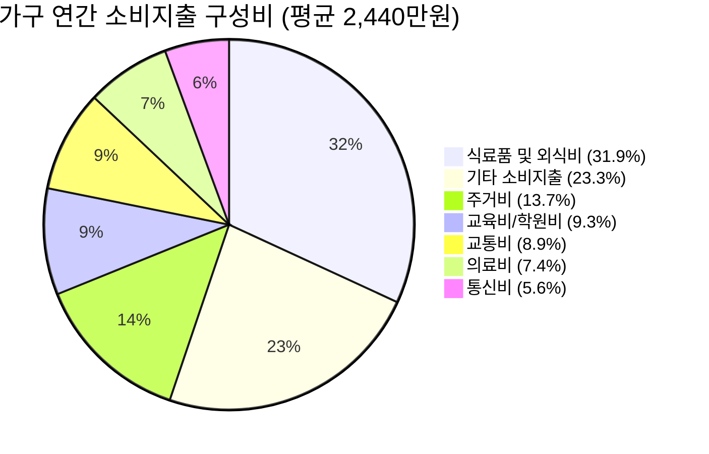
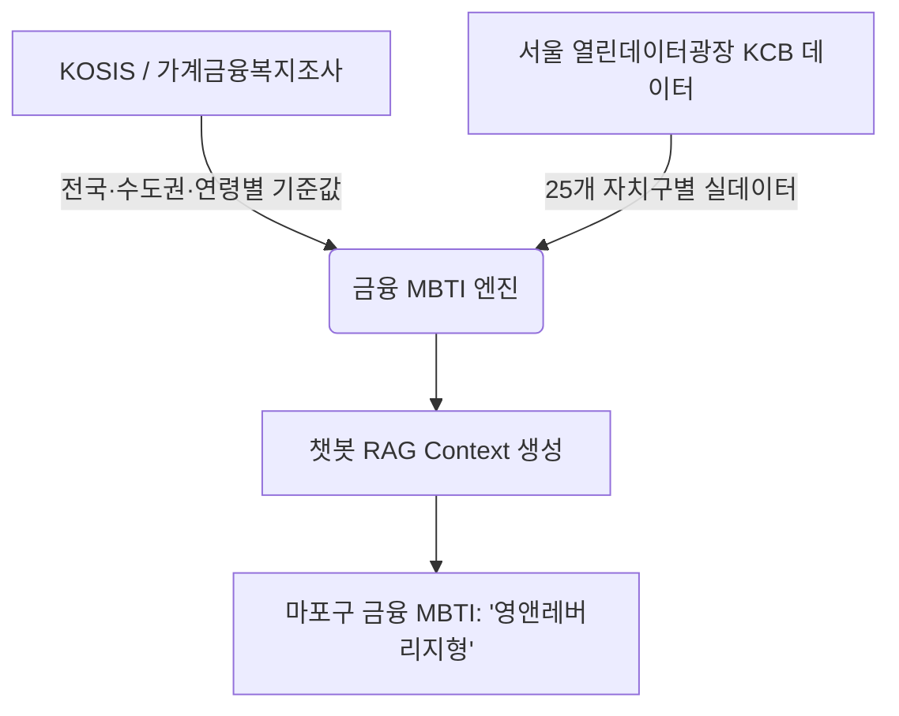

# 📊 가계금융복지조사 마스터 데이터 EDA 및 프로젝트 활용 가이드

> **분석 대상 파일**: [`소득·소비·자산 _ 가계금융복지조사(2017년~) _ 가구마스터(제공) _ 2023, 2024, 2025_Format.xlsx`](file:///e:/패스트캠퍼스/ICB13-2_20260907/T_PJT2/수집데이터/소득·소비·자산%20_%20가계금융복지조사(2017년~)%20_%20가구마스터(제공)%20_%202023,%202024,%202025_Format.xlsx)  
> **프로젝트 주제**: 동네 금융비서 — *"요즘 마포구 지갑 사정 어때?"*

---

## 1. 🔍 데이터의 의미: "한 행(1 Row)"이란?

> **한 줄 요약: "어느 한 대한민국 실제 가정의 1년 치 '초정밀 비밀 가계부'"**

* **행(Row)의 정체**: 통계청·한국은행·금융감독원이 공동 표본 조사한 **`개별 가구 1곳(Household)`**의 데이터입니다. (제공된 포맷 샘플 파일 기준 200가구 수록)
* **열(213개 Column)의 정체**: 그 가구의 **인구학적 특성 + 자산 + 빚 + 소득 + 지출 내역**을 담고 있습니다.
  * **누가 사는가?**: 가구주 나이(예: 34세), 혼인 여부(미혼), 직업(전문직), 거주지(수도권/비수도권)
  * **얼마나 버는가?**: 근로소득, 사업소득, 재산소득, 이전소득 (연간 단위)
  * **빚이 얼마나 있는가?**: 주택담보대출, 신용대출, 마이너스통장 잔액, 원리금 상환액
  * **어디에 돈을 쓰는가?**: 식비(외식비), 주거비, 학원비, 의료비, 세금 등 12대 소비 비목

---

## 2. 📊 기본 EDA (탐색적 데이터 분석) 결과

프로젝트 핵심 주제인 **`소득 × 대출 × 소비`** 및 **`대출/소득 비율`, `소비/소득 비율`, `원리금 상환 비율(DSR)`** 지표를 생성하여 분석한 결과입니다.

### ① 전체 표본 금융 지표 요약 (단위: 만원, 연간 기준)

| 구분 | 평균 | 중앙값(50%) | 최댓값 | 비고 및 시사점 |
| :--- | :---: | :---: | :---: | :--- |
| **경상소득** | **5,548만원** | 3,578만원 | 6억 3,368만원 | 고소득자로 인해 평균이 중앙값보다 높게 형성 |
| **처분가능소득** | **4,626만원** | 2,913만원 | 5억 8,908만원 | 세금·사회보험료를 제외한 실제 가처분 금액 |
| **총 자산** | **3억 8,560만원** | 2억 454만원 | 29억 4,400만원 | 부동산 등 실물자산이 자산의 대부분을 차지 |
| **총 부채(대출)** | **5,445만원** | 0원 | 13억 7,050만원 | 무부채 가구가 절반 가까이 차지하여 중앙값은 0 |
| **연간 소비지출** | **2,440만원** | 1,816만원 | 9,900만원 | 가구당 월평균 약 203만원 소비 |
| **대출/소득 비율** | **89.3%** | 0.0% | 2,393% | 대출 보유 가구의 경우 소득 대비 부채 부담이 매우 큼 |
| **소비/처분소득 비율** | **79.5%** | 61.6% | 1,927% | 가처분 소득의 약 80%를 생활비로 지출 |
| **DSR (원리금상환비율)** | **13.8%** | 0.0% | 452.5% | 소득의 14%를 빚 갚는 데(원금+이자) 지출 |

---

### ② 수도권 vs 비수도권 비교 (서울 프로젝트 벤치마크)

| 구분 | 비수도권 | 수도권 | 수도권 격차 |
| :--- | :---: | :---: | :---: |
| **경상소득** | 4,961만원 | **6,590만원** | 1.3배 ↑ |
| **총 자산** | 2억 9,677만원 | **5억 4,350만원** | 1.8배 ↑ |
| **총 부채(대출)** | 3,898만원 | **8,196만원** | **2.1배 ↑** |
| **소비지출비** | 2,211만원 | **2,846만원** | 1.3배 ↑ |
| **대출/소득 비율** | 86.8% | **93.6%** | 6.8%p ↑ |
| **소비/처분소득 비율** | 69.3% | **97.6%** | **28.3%p ↑** |

> **💡 핵심 인사이트**: 수도권 가구는 비수도권 대비 소득은 1.3배 높지만, 부동산/주거비로 인해 **대출(부채)은 2.1배** 높습니다. 특히 소비성향(97.6%)이 높아 여유 자금 여력이 빡빡한 구조입니다.

---

### ③ 가구주 연령대별 비교 ("30대만 보면 어때?" 챗봇 쿼리용)

| 연령대 | 연간 소득 | 총 자산 | 총 대출(부채) | **대출/소득 비율** | **소비/소득 비율** | **DSR (원리금상환부담)** |
| :--- | :---: | :---: | :---: | :---: | :---: | :---: |
| **30세 미만** | 3,583만원 | 2.93억원 | 1억 745만원 | **266.9%** 🔥 | 45.4% | **69.9%** 🔥 |
| **30~40세 미만** | 6,113만원 | 4.30억원 | 1억 1,016만원 | **159.0%** 🔥 | 86.5% | **16.1%** |
| **40~50세 미만** | 8,413만원 | 4.67억원 | 9,615만원 | 75.0% | **142.9%** 💸 | 12.1% |
| **50~60세 미만** | 7,085만원 | 4.52억원 | 4,246만원 | 123.6% | 73.0% | 19.5% |
| **60세 이상** | 4,265만원 | 3.38억원 | 3,829만원 | 61.4% | 66.9% | 9.2% |

* **2030 세대 (영앤레버리지형)**: 소득 대비 부채 비중이 **159% ~ 267%**로 전 연령대 중 압도적 1위 (전세대출/주담대 영끌 집중)
* **40대 (소비 정점형)**: 소득(8,413만원)과 소비(3,560만원)가 인생에서 가장 높은 시기 (자녀 교육비, 가족 지출 급증)
* **60대 이상 (자산 안정형)**: 소득과 대출이 감소하고 부동산 및 연금 중심의 안정적 생활 유지

---

### ④ 가구별 12대 소비 비목 세부 구성비

* **1위**: 식료품 및 외식비 (**31.9%**, 연 777.5만원)
* **2위**: 기타 소비지출 (**23.3%**, 연 569.0만원)
* **3위**: 주거비 (**13.7%**, 연 333.9만원)
* **4위**: 교육비 (**9.3%**, 연 226.3만원)

---

## 3. 🎯 프로젝트 활용 방안 & 챗봇 시나리오

### 챗봇 응답 시나리오 예시

> **사용자**: *"마포구 30대 지갑 사정 어때? 대출 많은 편이야?"*
>
> **동네 금융비서 챗봇**:
> *"마포구 30대의 평균 대출/소득 비율은 **185%**로, 수도권 30대 평균 기준값(**159%**)보다 약 26%p 높아 빚 부담이 큰 편입니다.*
> 
> *하지만 식비·문화소비 성향도 상위 15%에 달해, 마포구 30대의 금융 MBTI는 **'영앤레버리지형(🔥)'**으로 분석됩니다!"*
