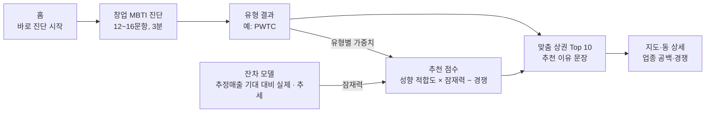

# 틈새 상권 발굴 솔루션 기획서

> 창업 성향 진단(MBTI)과 소비 잠재력 잔차 분석을 결합한 맞춤형 틈새 상권 발굴 솔루션
> 작성일: 2026-10-10 · 대시보드: <https://1joklpfclau-hecsqfwbfsrupvrs8tgdml.streamlit.app/>
> 원본 문서(Claude Docs): <https://claude.ai/code/artifact/937a6611-1efc-4261-9a3c-60227b4a8d04>

## 1. 현재 대시보드 진단

전체 완성도는 약 40%입니다. 상권 데이터·EDA·지도는 거의 끝났지만, 주제의 절반인 **창업 성향 진단은 아직 없고**, 나머지 절반인 **잔차 분석은 타깃 문제로 재작업이 필요**합니다.

배포 앱(Clau\_pjt, 10개 페이지)과 커밋 10개(최종 2026-09-30)를 기준으로 봤습니다.

| 주제 구성요소 | 지금 있는 것 | 완성도 | 빠진 것 |
| --- | --- | --- | --- |
| 데이터 파이프라인 | 425개 행정동 × 49열 Parquet, DuckDB 조회, 경계 보정 | 90% | 새 타깃(추정매출) 컬럼 |
| EDA | 표 16개·그림 19개, 툴팁·해설 아코디언 | 90% | 발표용으로 압축 |
| 지도·행정동 상세 | 자치구→행정동 folium 지도, 동 프로필 | 85% | 추천 결과를 지도에 표시 |
| 소비 잠재력 잔차 모델 | Ridge(R² 0.63), GroupKFold, 배율·잔차 추세·기회 유형 6종 | 50% | 타깃 교체 후 재추정 (수정사항 페이지가 스스로 지적) |
| 금융MBTI | 행정동 주민 4개 군집(자산안정·알뜰안정·생활압박·영앤레버리지) | 60% | 이건 **동네 소비자** 성향이지 **창업자** 성향이 아님 |
| 창업 성향 진단 | 없음 | 0% | 문항, 유형 산출, 결과 화면 |
| 맞춤 추천 엔진 | 기회 탐색 페이지의 수동 필터 + Top 10 | 20% | 성향 → 가중치 → 적합도 점수 → 추천 |
| 서비스 흐름 | 메뉴가 EDA 순서로 나열 | 30% | 진단 → 추천 → 상세로 이어지는 사용자 동선 |

가장 큰 리스크는 타깃입니다. `지출_총금액`은 결제 주소지 기준이라 여가·문화가 64%이고, 상위 3개 동이 서울 전체의 45%를 차지합니다. 지금의 배율·기회 유형은 "숨은 상권"보다 "대형 결제처 위치"에 가깝습니다. 팀이 이미 `OA-15572 추정매출`로 바꾸는 방향을 정해 두었으니, 이를 1~2주차에 끝내는 것이 전체 일정의 전제입니다.

## 2. 추가로 해야 할 작업

필수 4개를 5주 안에 끝내고, 권장·선택은 남는 시간만큼 합니다.

| 우선순위 | 작업 | 내용 | 대시보드에 닿는 곳 |
| --- | --- | --- | --- |
| 필수 1 | 타깃 교체 · 잔차 재추정 | `OA-15572` 추정매출을 행정동으로 집계(음식·소매·생활서비스), 소득·인접 동 변수 추가, 잔차 신뢰구간으로 라벨 | 모든 페이지의 배율·기회 유형 |
| 필수 2 | 창업 MBTI 진단 | 4축 문항 12~16개 → 16유형(또는 4유형) 산출, 유형 카드 | 새 페이지 `창업 성향 진단` |
| 필수 3 | 성향 기반 추천 엔진 | 성향 → 지표 가중치 → 행정동 적합도 점수 → Top N + 추천 이유 문장 | 새 페이지 `내 맞춤 상권` |
| 필수 4 | 사용자 동선 재구성 | 홈 = 진단 시작, EDA는 `분석 근거` 메뉴로 내림, 추천 → 지도 → 상세로 연결 | `app.py` 내비게이션 |
| 권장 | 업종 단위 추천 | 추정매출의 업종 코드로 "이 동에서 무엇을" 까지 제시, 점포 수·개폐업률(`OA-15577`)로 경쟁 강도 | 추천 카드·행정동 상세 |
| 권장 | 검증 | 상권변화지표(`OA-15576`)와 잔차 추세 비교, 추천 동 2~3곳 현장 또는 로드뷰 확인 | `분석 근거` 페이지 |
| 권장 | 유출입 검증 | `서울시민의 일별 소비지역별` 데이터로 '유출보완형'이 실제로 있는지 확인 | 기회 유형 설명 |
| 선택 | 추천 결과 내보내기 | 진단 결과 + 추천 동 PDF/CSV 리포트 | 추천 페이지 다운로드 |
| 선택 | 사용자 테스트 | 예비 창업자 또는 동기 5~10명에게 진단 → 추천 만족도 설문 | 발표 자료 |

`revision.py`는 최종본에서 `분석 근거` 페이지의 "타깃을 왜 바꿨나"로 줄여 남기면 발표에서 강점이 됩니다. 또 Streamlit Cloud는 기존 `src/` 모듈을 새로 읽지 않으므로, 진단·추천 로직은 `src/survey.py`, `src/recommend.py` 같은 새 모듈에 두세요.

## 3. 기획서

**한 줄 정의:** 예비 창업자의 성향을 4축 MBTI로 진단하고, 인구·인프라에 비해 소비가 덜 되는(잔차가 음수이면서 좋아지는) 서울 행정동 가운데 그 성향에 맞는 곳을 추천하는 Streamlit 서비스입니다.

### 3.1 배경과 문제

- 기존 상권분석 서비스(서울시 상권분석서비스, 소상공인 상권정보)는 이미 매출이 큰 곳을 보여 줍니다. 그런 곳은 임대료와 경쟁도 큽니다.
- 창업자마다 위험 감수도, 자본, 원하는 고객이 다른데 추천은 모두에게 같습니다.
- 그래서 "저평가된 곳"과 "나에게 맞는 곳"을 동시에 찾는 도구가 필요합니다.

### 3.2 목표

1. 사용자가 3분 안에 진단을 끝내고 자신의 창업 유형을 얻는다.
2. 유형별로 서로 다른 행정동 Top 10과 추천 이유를 본다.
3. 추천의 근거(모델, 잔차, 검증)를 분석 근거 페이지에서 확인할 수 있다.

### 3.3 데이터

| 데이터 | 용도 | 상태 |
| --- | --- | --- |
| 서울시 상권분석서비스 `OA-15572` 추정매출 + `OA-15560` 영역 | 새 타깃 (점포 기준 매출, 업종별) | 팀 폴더에 있음 |
| 상주·직장·길단위인구, 집객시설, 아파트 (`OA-22160`~`22184`) | 기대 매출 설명변수 | 사용 중 |
| 가구 행정동별 생활금융 통계, SKT 시민생활 | 소득·청년·1인가구, 주민 금융MBTI | 사용 중 (소득은 모델에 미반영) |
| `OA-15577` 점포, 소상공인 상가정보 | 업종별 경쟁 강도, 개폐업률 | 팀 폴더에 있음 |
| `OA-15576` 상권변화지표 | 잔차 추세 외부 검증 | 팀 폴더에 있음 |
| 서울시민 일별 소비지역별(행정동) | 유출입 검증 | 수집데이터에 있음 |
| apt.wiki 키워드, 네이버 검색 트렌드 | 추천 이유 문장, 트렌드 보조 | 사용 중 |

### 3.4 분석 방법 ① — 창업 MBTI 진단

네 축은 모두 대시보드에 이미 있거나 만들 수 있는 행정동 지표와 1:1로 대응되게 설계했습니다. 그래야 진단 결과가 추천 점수로 바로 이어집니다.

| 축 | 양쪽 성향 | 문항 예시 | 연결되는 행정동 지표 |
| --- | --- | --- | --- |
| 위험 | **P** 선점(Pioneer) ↔ **S** 안정(Stable) | "검증되지 않았더라도 임대료가 오르기 전에 들어가고 싶다" | 잔차 추세(크면 P), 잔차 변동성·폐업률(낮으면 S) |
| 고객 | **W** 직장인·유동(Worker) ↔ **R** 주민(Resident) | "단골보다 지나가는 사람을 대상으로 하고 싶다" | 직주비, 주중/주말 유동 비율 |
| 아이템 | **T** 트렌드(Trend) ↔ **L** 생활밀착(Life) | "새로운 컬처나 SNS 화제성이 중요하다" | 청년·1인가구 비율, 상권 원형, 네이버 트렌드 vs 업종 공백(약국·반찬 등) |
| 자본 | **H** 고자본(High) ↔ **C** 소자본(Compact) | "초기 투자는 1억 원 이하로 하고 싶다" | 아파트 시가(임대료 대리지표), 자치구 임대료 |

- 축마다 5점 리커트 문항 3~4개, 총 12~16문항. 점수는 축별 0~1로 정규화하고 0.5를 기준으로 문자를 정합니다 (예: `PWTC` = 소자본 트렌드 선점형).
- 16유형은 발표용 페르소나 이름과 한 줄 설명을 붙입니다. 시간이 부족하면 위험×고객 2축 4유형부터 만들고 나머지 두 축을 필터로 받습니다.
- 기존 `금융MBTI`는 "이 동네 주민은 어떤 소비자인가"로 추천 카드에 그대로 쓰고, 창업자 유형과 나란히 보여 줍니다.

### 3.5 분석 방법 ② — 소비 잠재력 잔차

1. 타깃: 행정동·분기별 추정매출(음식·소매·생활서비스) 로그값.
2. 설명변수: 상주·직장·유동인구, 집객시설, 지하철역, 아파트, 소득, 인접 동 가중평균 매출.
3. 모델: Ridge와 LightGBM을 `GroupKFold(행정동)`로 비교하고, out-of-fold 예측으로 잔차를 만듭니다.
4. 지표 3개: 잔차 수준(지금 얼마나 덜 쓰나), 잔차 추세(12분기 기울기), 신뢰구간(부트스트랩으로 0을 벗어나는지).
5. 기회 유형 6종은 유지하되, 신뢰구간이 0을 포함하면 `기대수준`으로 둡니다.

### 3.6 추천 점수

성향 벡터에서 지표별 가중치를 만들고, 행정동마다 적합도와 잠재력을 곱합니다.

```latex
\text{Score}_d = \underbrace{\sum_k w_k(\text{type}) \cdot z_{d,k}}_{\text{성향 적합도}} \times \underbrace{\big(1 + \alpha\,\text{Potential}_d\big)}_{\text{잔차 잠재력}} - \beta\,\text{Competition}_d
```

- `z` = 표준화한 행정동 지표(직주비, 청년비율, 아파트 시가 등), `w` = 유형별 가중치 표(룰 기반으로 시작).
- `Potential` = 잔차 수준이 음수일수록, 추세가 양수일수록 큽니다. `Competition` = 업종 점포 밀도·폐업률.
- 해석주의 동(배율 극단)은 추천에서 빼고, 추천 카드에는 "왜 이 동인가"를 상위 기여 지표 3개로 문장화합니다.

### 3.7 기대효과

- 예비 창업자: "잘 되는 곳"이 아닌 "나에게 맞고 아직 덜 차오른 곳"을 후보로 얻음.
- 지자체·창업지원기관: 유출보완형 동네에 필요한 생활 업종을 파악하는 정책 자료로 활용.

### 3.8 한계

- 임대료는 자치구 단위만 공개되어 아파트 시가를 대리변수로 씁니다.
- 추정매출도 카드 기반 추정치이고, 잔차에는 누락 변수가 섞입니다. 결과는 "후보 발굴"이지 "창업 성공 예측"이 아닙니다.
- 진단 문항의 신뢰도는 소규모 사용자 테스트로만 확인합니다.

### 3.9 서비스 흐름

사용자는 홈에서 바로 진단을 시작해 결과 → 추천 → 지도·상세로 이동하고, 분석 근거는 별도 메뉴에서 봅니다.



윗줄은 사용자가 보는 화면, 아랫줄은 뒤에서 돌아가는 계산입니다. 새로 만들 것은 진단·유형 결과·추천 점수 세 가지이고, 지도·동 상세·잔차 모델은 기존 것을 고쳐 씁니다.

## 4. 7주 주별 계획

분석을 3주차에 확정하고, 진단·추천 기능을 5주차까지 붙인 뒤, 마지막 2주는 검증과 발표에 씁니다. 주차는 월요일 시작 기준(10월 12일~11월 29일)으로 잡았습니다.

| 주차 | 기간 | 목표 | 핵심 작업 | 산출물 |
| --- | --- | --- | --- | --- |
| 1주 | 10/12~10/18 | 기획 확정 · 새 타깃 준비 | 기획서 확정, 역할 분담 / `OA-15572` 추정매출을 행정동·분기로 집계 / 기존 타깃과 상관 비교 / 창업 MBTI 4축 문항 초안 | 기획서 v1, `sales_dong.parquet`, 문항 초안 16개 |
| 2주 | 10/19~10/25 | 잔차 모델 재추정 | 소득·인접 동 변수 추가 / Ridge vs LightGBM, GroupKFold / 잔차 수준·추세·신뢰구간 산출 / 명동·여의동 자기검증 | 모델 비교표, `residual.parquet` |
| 3주 | 10/26~11/01 | 분석 확정 · 진단 로직 | 기회 유형 6종 재분류, `OA-15576` 상권변화지표로 검증 / 문항 확정, 축 점수→유형 변환 함수 / 16유형 이름·설명 | **중간점검: 분석 결과 확정**, `src/survey.py` |
| 4주 | 11/02~11/08 | 진단 페이지 · 추천 엔진 | `창업 성향 진단` 페이지(문항→결과 카드) / 유형별 가중치 표 / 적합도·잠재력·경쟁 점수 함수 | `pages/survey.py`, `src/recommend.py` |
| 5주 | 11/09~11/15 | 추천 페이지 · 동선 연결 | `내 맞춤 상권` Top 10 + 추천 이유 문장 / 추천 동을 지도에 강조 / 행정동 상세에 업종 공백·경쟁 추가 / 내비게이션 재구성 | **기능 완성 (코드 프리즈)** |
| 6주 | 11/16~11/22 | 검증 · 다듬기 | 유형별 추천이 실제로 다른지 확인 / 사용자 테스트 5~10명 / 오류·문구 수정, EDA를 `분석 근거`로 압축 / 배포 부하 확인 | 테스트 결과 요약, 최종 배포본 |
| 7주 | 11/23~11/29 | 발표 | 발표 자료 · 데모 시나리오(페르소나 2명) / README·보고서 정리 / 리허설 2회 | 발표 자료, 최종 보고서, 데모 영상(백업) |

다음 주에 바로 할 일:

- [ ] 기획서 팀 리뷰 후 v1 확정
- [ ] 분석 담당 / 진단·추천 담당 / 대시보드·발표 담당 정하기
- [ ] `상권.zip`에서 `OA-15572`, `OA-15560` 풀어 행정동 집계
- [ ] 창업 MBTI 문항 16개 초안 작성

## 5. 리스크와 대응

| 리스크 | 신호 | 대응 |
| --- | --- | --- |
| 새 타깃으로도 R²가 낮거나 결과가 상식과 충돌 | 2주차 끝 R² < 0.5, 강남 핵심 동이 저평가 | 업종군별 모델로 나누기, 잔차 수준 대신 추세 중심으로 주장 축소 |
| 창업 MBTI가 추천을 바꾸지 못함 | 유형별 Top 10이 70% 이상 겹침 | 가중치 차이를 키우고, 잠재력 필터 후 성향 적합도로 재정렬 |
| 일정 지연 | 3주차 중간점검에서 분석 미확정 | 16유형 → 4유형(위험×고객)으로 축소, 업종 단위 추천은 생략 |
| Streamlit Cloud 배포 오류 | `AttributeError`, 앱 잠듦 | 새 기능은 새 모듈에, 발표 전 Reboot + 로컬 실행·데모 영상 백업 |
| 대용량 원본(추정매출, 체류인구) 처리 부담 | 저장소 용량 초과 | 전처리 스크립트에서 집계 후 Parquet만 커밋 |

### 최종 발표 체크리스트

- [ ] 홈에서 3분 안에 진단 → 추천까지 도달
- [ ] 서로 다른 두 유형의 추천 결과가 눈에 띄게 다름
- [ ] 추천마다 "왜 이 동인가" 문장과 근거 지표가 보임
- [ ] 타깃 교체 전후 비교가 `분석 근거`에 있음
- [ ] 한계와 데이터 출처를 한 페이지에 정리
- [ ] 데모 영상과 로컬 실행 환경 백업
