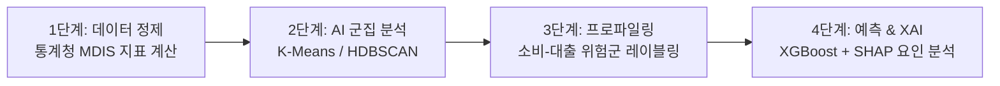

# 대출 차주의 위험 소비 패턴 분석 및 공공데이터 기반 AI 분류 가이드

본 문서는 대출을 상환하지 않고 지속적으로 소비/탕진하는 차주의 행동 패턴과, 이를 실제 공공데이터 및 머신러닝으로 식별·분류하는 분석 방법론을 정리한 문서입니다.

---

## 💬 Q1. 대출을 받고도 빚을 갚지 않고 계속 돈을 쓰는 패턴과 원인이 있을까요?

> **Q. 사용자 질문:**  
> "대출을 받고도 돈을 계속 쓰는 패턴이 있을까? 조금씩이라도 갚지 않고 계속 쓰는 사람들. 예를 들어서 도박이나 단타 주식을 위해 (자기가 따낸다는 확신이 있어서) 대출을 하는 사람 같은거? 그 외에도 다른 이유가 있을까?"

---

### 💡 A1. 고위험 차주의 대표적인 5가지 위험 소비 행동 패턴

금융 데이터 및 행동경제학 관점에서 대출금을 상환하지 않고 소비를 지속하는 차주는 다음과 같은 5가지 유형으로 분류됩니다.

```
┌────────────────────────────────────────────────────────────────────────┐
│                   고위험 차주의 5가지 위험 소비 패턴                   │
├────────────────────────────────────────────────────────────────────────┤
│ 1. 투기·도박형       : '한 방이면 다 갚는다' (주식 단타, 코인, 도박)   │
│ 2. 돌려막기형       : '밑 빠진 독에 물 붓기' (생계 곤란, 필수 지출)    │
│ 3. 과시소비(FLEX)형 : 'SNS 속 내 모습 유지' (명품, 외식, 리볼빙)      │
│ 4. 자포자기형       : '어차피 못 갚아, 회생 신청' (한도 소진 후 잠적)  │
│ 5. 자영업 매몰비용형: '조금만 버티면 장사 되겠지' (적자 매장 유지)     │
└────────────────────────────────────────────────────────────────────────┘
```

#### 1. 🎰 투기·도박 중독형 ("한 방이면 다 갚는다")
- **원인 & 심리**: '도박사의 오류'와 '과잉 확신(Overconfidence)'으로 인해 "이번 투자로 대출 원금을 전액 상환하고 부자가 될 수 있다"고 맹신.
- **데이터 특징**:
  - 대출 실행 직후 가상화폐 거래소 또는 증권 계좌로 거액 송금.
  - 심야 시간대(새벽 1~4시) 소액 결제 및 입출금 빈도 급증.

#### 2. 🌀 돌려막기 만성 적자형 ("밑 빠진 독에 물 붓기")
- **원인 & 심리**: 소득보다 기본 생활비(월세, 공과금, 식비, 병원비)가 더 커서 카드 연체를 막기 위해 대출을 반복 실행.
- **데이터 특징**:
  - 카드 결제일 직전에 정확히 신규 대출(카드론, 현금서비스, 대부업) 실행.
  - 3개 이상의 다중채무 기관 보유.
  - 지출 항목이 사치가 아닌 '마트, 편의점, 병원비, 대중교통' 등 필수 생계비에 집중.

#### 3. 🛍️ 과시 소비 & 현상유지 편향형 ("SNS 속 내 모습 유지하기")
- **원인 & 심리**: 소득이 정체되거나 감소했음에도 과거의 높은 생활 수준(명품, 호캉스, 외제차)을 낮추지 못함.
- **데이터 특징**:
  - 대출 잔액이 늘어남에도 백화점, 고급 외식, 미용/피부과 결제 비중 유지.
  - 신용카드 리볼빙(일부결제금액이월약정) 상시 이용.

#### 4. 🏳️ 자포자기 & 모럴 해저드형 ("어차피 못 갚아, 회생 신청하지 뭐")
- **원인 & 심리**: 빚이 감당 가능한 한계를 넘어 상환을 포기하고 개인회생/파산을 염두에 둠.
- **데이터 특징**:
  - 연체 직전 수 주 동안 카드 한도 끝까지 물품 구매 또는 상품권 현금화(카드깡) 시도.
  - 급격한 소비 폭증 이후 모든 금융 거래가 일시에 '0'으로 중단.

#### 5. ☕ 자영업 매몰비용 오류형 ("조금만 버티면 장사 잘되겠지")
- **원인 & 심리**: '매몰비용의 오류'로 인해 이미 투입된 인테리어비와 권리금이 아까워 대출로 적자 매장 유지.
- **데이터 특징**:
  - 매출은 지속적으로 하락하나 소상공인 대출 및 신용대출이 유입되어 임대료/인건비로 소진.

---

## 💬 Q2. 공공데이터에서 위 소비 패턴을 가진 사람들을 구분할 수 있는 방법이 있을까요?

> **Q. 사용자 질문:**  
> "공공데이터에서 위 소비 패턴을 가진 사람들을 구분할 수 있는 방법이 있을까?"

---

### 💡 A2. 공공 마이크로데이터 기반 식별 및 AI 분석 방법론

연구 및 정책 분석용으로 개방된 **가명화 마이크로데이터(Microdata)**를 활용하면 가구/개인 단위의 소비와 부채 패턴을 명확히 분류할 수 있습니다.

### 1. 활용 가능한 핵심 공공데이터
1. **통계청 [가계금융복지조사] 마이크로데이터** ([MDIS 포털](https://mdis.kostat.go.kr))
   - 가구별 소득, 담보/신용대출/사채 잔액, 원리금 상환액, DSR
   - 세부 지출 항목: 식비, 주거비, 보건(병원비), 오락/문화(복권/취미 포함), 외식/사치재
   - 부채 상환 부담 여부 및 상환 계획 설문 데이터 포함
2. **한국신용정보원 [CreDB (금융 빅데이터 개방시스템)]** ([CreDB 포털](https://credb.kcredit.or.kr))
   - 차주별 대출 기관 수(1·2금융, 대부업), 카드론/현금서비스/리볼빙 이용액, 연체 이력
3. **공공데이터포털 / 금융데이터거래소 [업종별 카드 소비 데이터]**
   - 백화점, 명품, 마트, 병원, 유흥, 배달 등 업종별 결제 비중

---

### 2. 데이터 기반 유형 식별 지표 (파생 변수 공식)

| 위험 유형 | 데이터 식별 핵심 공식 | 데이터 속 특징적 지표 |
| :--- | :--- | :--- |
| **🌀 돌려막기형** | **`DSR > 70%`** + **`필수지출 비중 > 60%`** | 다중채무(기관수 ≥ 3), 여가/문화 지출 0원 수렴 |
| **🛍️ 과시소비형** | **`부채 증가율 > 소득 증가율`** + **`선택지출 비중 > 50%`** | 백화점/의류/외식비 지출 상위 10% 유지, 리볼빙 이용 |
| **🎰 투기·투자형** | **`금융부채 급증`** + **`잉여자금 대비 금융자산 투자 급증`** | 필수 소비 극소화, 저축/투자 지출 몰림 |
| **☕ 자영업 매몰형**| **`사업소득(매출) 연속 감소`** + **`사업자 대출 지속 증가`** | 매출 적자 상태에서 임대료/인건비 고정비만 지출 |
| **🏳️ 자포자기형** | **`총부채 > 총자산 (자본잠식)`** + **`연체 발생 이력`** | 한도 소진 후 금융 활동 전면 중단 |

---

### 3. AI 머신러닝 분석 3단계 파이프라인



1. **데이터 전처리 & 파생변수 생성**: 소득 대비 부채 비율(DSR), 필수 지출 비중, 선택적 지출 비중 계산
2. **비지도 군집화(Clustering)**: `K-Means`, `HDBSCAN` 알고리즘으로 소비-대출 패턴별 가구 자동 군집화
3. **군집 프로파일링**: 레이더 차트 시각화 및 군집별 페르소나 부여 ("생계형 취약 차주", "과소비형 위험 차주" 등)
4. **분류 모델 및 XAI**: 정상 상환군 vs 위험군 분류 모델(`XGBoost`) 학습 후 `SHAP`으로 어떤 지출 항목이 부실 위험에 가장 크게 기여하는지 요인 추출

---

### 🌟 프로젝트 기획 포인트 & 가치
- **데이터 확보성 100%**: 통계청 MDIS에서 무료로 다운로드하여 즉시 분석 가능.
- **탄탄한 비즈니스 스토리**: *"단순히 빚이 많다고 다 같은 대출자가 아니다. 생계형 취약 차주에게는 채무 조정 및 정책 지원을, 과소비/투기형 차주에게는 한도 제한 및 부실 조기경보를 제공하는 차별화된 AI 관리 시스템"*으로 완벽한 포트폴리오를 구성할 수 있습니다.
