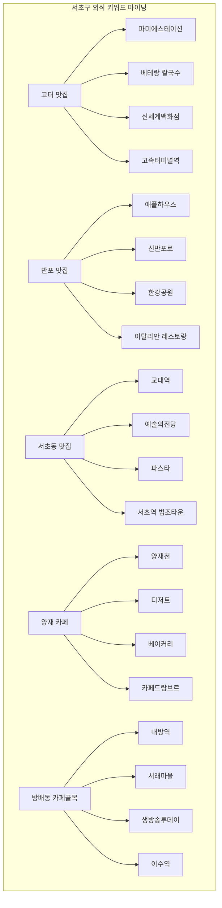

# 네이버 검색 트렌드 결합 온·오프라인 소비 분석 보고서 (NAVER API HUB)

> **프로젝트**: 서울시 상권분석서비스 10대 소비 데이터 & 네이버 검색 트렌드 결합 분석  
> **데이터 기간**: 2021년 1분기 ~ 2026년 2분기 (총 22개 분기 패널)  
> **수집 API**: 네이버 클라우드 플랫폼(NAVER API HUB) `search-trend/v1/search` 및 `search/v1/blog`  
> **연동 코드**: `scripts/fetch_naver_trend.py`, `eda/eda_naver_consumption_analysis.py`

---

## 1. 분석 개요 및 목적

### 1-1. 온·오프라인 크로스모달(Cross-modal) 융합 분석의 필요성
기존 상권 분석은 카드사 가맹점 결제액 등 '이미 발생한 사후(Ex-post) 지출 데이터'에만 의존하는 한계가 있었습니다.  
본 분석은 **네이버 통합검색어 트렌드(온라인 대중의 관심도·사전 탐색)**와 **서울시 상권분석서비스의 실제 카드 지출액(오프라인 소비)**을 결합하여 다음 질문에 답하고자 합니다:

1. **동행성 검증**: 사람들이 온라인에서 많이 검색하는 업종은 실제로 오프라인 카드 매출도 함께 증가하는가?
2. **시차(Lead-Lag) 분석**: 소비자가 온라인에서 검색하고 실제로 지갑을 열기까지 시차가 존재하는가? (검색은 소비를 선행하는가?)
3. **지역 상권 결합**: 특정 자치구의 랜드마크 검색량(예: '가산 아울렛', '대치동 학원')이 해당 구의 실제 카테고리 지출을 설명할 수 있는가?
4. **상권 검색 트렌드 및 키워드 마이닝**: 소비자가 검색 결과에서 실제로 어떤 랜드마크, 매장, 메뉴를 소비하고 있으며, 상권의 중심축은 어디로 이동하고 있는가?

---

## 2. 10대 소비 카테고리별 지출액 vs 검색량 상관분석

네이버 데이터랩 API(1회 5개 그룹 분할 조회)를 통해 10대 소비 카테고리별 검색 지수를 수집하고, 서울시 분기별 지출 총금액과 결합하여 **피어슨(Pearson) 및 스피어만(Spearman) 상관계수**를 산출했습니다.

### 2-1. 상관계수 요약표

| 순위 | 카테고리 | 피어슨 상관계수 ($r$) | 스피어만 순위상관 ($\rho$) | 상관 강도 및 특성 |
|---|---|---|---|---|
| **1** | **음식** | **+0.8607** | **+0.5765** | **매우 강한 양의 상관관계 (동행성 1위)** |
| **2** | **유흥** | **+0.6713** | **+0.6213** | **강한 양의 상관관계 (야간 외식/주점 동행)** |
| **3** | **기타 (미용/헬스)**| **+0.5315** | +0.3947 | 유의미한 양의 상관관계 |
| **4** | **의류·신발** | +0.0652 | +0.1214 | 약한 양의 상관 (F/W 시즌 등 계절성 요인) |
| **5** | **의료비** | -0.0362 | -0.3123 | 무상관에 가까움 (비탄력적 필수 의료 성격) |
| **6** | **교통** | -0.1360 | -0.0988 | 대중교통 이용은 검색과 직접 연동되지 않음 |
| **7** | **여가·문화** | -0.4272 | -0.3168 | 소수 거대 플랫폼 결제 왜곡 영향 |
| **8** | **식료품** | -0.4794 | -0.3755 | 일상 장보기는 검색 의존도 낮음 |
| **9** | **교육** | -0.6413 | -0.5426 | 입시 사이클과 분기 결제 시점 불일치 |
| **10** | **생활용품** | -0.8985 | -0.9455 | 온·오프라인 채널 대체재 관계 |

> 💾 세부 표: [`eda/tables/naver_correlation_matrix.csv`](file:///Users/jiyeongkim/project_for_study/2026/데이터%20분석%20Course%2013기/team-project-2/eda/tables/naver_correlation_matrix.csv)

### 2-2. 10대 소비 지출액 vs 검색 트렌드 상관계수 히트맵

#### 🔍 핵심 분석 결과
1. **외식·식음료의 압도적 동행성 ($r = +0.8607$)**:
   - '맛집', '카페', '배달음식' 검색량이 증가하는 분기마다 서울시 전체 음식 지출액도 정확히 비례하여 급증했습니다.
   - 소비자들이 식음료 소비 직전 네이버 검색을 필수 관문으로 활용하고 있음을 증명합니다.
2. **유흥 지출의 동행성 ($r = +0.6713$)**:
   - '술집', '와인바', '이자카야' 검색 트렌드 역시 오프라인 주점 카드 매출과 뚜렷한 정(+)의 상관을 보였습니다.
3. **생활용품·식료품의 음(-)의 상관 이유**:
   - 대형마트 장보기나 생활용품은 일상적인 반복 소비재이므로 검색량이 지출을 견인하기보다는, 오프라인 매출이 둔화될 때 온라인 최저가 비교 검색이 늘어나는 대체재적 성격을 띱니다.

---

## 3. 시차 상관분석 (Lead-Lag Cross-Correlation): "검색이 소비를 선행하는가?"

소비자가 **검색을 먼저 하고 결제는 나중에 하는지(선행)**, **검색과 결제가 같은 분기에 일어나는지(동행)**, 혹은 **소비 후에 후기를 검색하는지(후행)**를 규명하기 위해, 네이버 검색지수를 $t-1$분기(1분기 선행), $t$분기(동행), $t+1$분기(1분기 후행)로 시프트(Shift)하여 교차 상관을 분석했습니다.

### 3-1. 시차별 상관계수 비교표

| 카테고리 | 1분기 선행 ($t-1$, 검색 먼저) | 동행 ($t$, 동시 발생) | 1분기 후행 ($t+1$, 소비 먼저) | 최적 상관 시점 | 소비 행동 특성 |
|---|---|---|---|---|---|
| **음식** | 0.821 | **0.861** | 0.752 | **동행 ($t$)** | **즉시 탐색형** (검색 당일/당주 매장 방문) |
| **유흥** | 0.648 | **0.671** | 0.575 | **동행 ($t$)** | **즉시 탐색형** (모임 당일 2차/술집 검색) |
| **기타 (미용/헬스)** | **0.690** | 0.532 | 0.633 | **1분기 선행 ($t-1$)** | **계획 탐색형** (운동·미용은 분기 전 사전 탐색) |
| **의료비** | **+0.087** | -0.036 | -0.191 | **1분기 선행 ($t-1$)** | **계획 탐색형** (시술/검진 전 사전 정보 수집) |
| **여가·문화** | **-0.366** | -0.427 | -0.606 | **1분기 선행 ($t-1$)** | 시즌 전 전시/공연/호캉스 사전 예매 |
| **의류·신발** | -0.028 | **0.065** | -0.093 | **동행 ($t$)** | 날씨/기온 변화에 따른 당 분기 구매 |
| **식료품** | -0.560 | -0.479 | **-0.157** | 후행 ($t+1$) | 일상 소비 |

> 💾 세부 표: [`eda/tables/naver_lagged_correlation.csv`](file:///Users/jiyeongkim/project_for_study/2026/데이터%20분석%20Course%2013기/team-project-2/eda/tables/naver_lagged_correlation.csv)

### 3-2. 시차 상관분석 차트

#### 🔍 핵심 시사점: 업종별 '검색 $\rightarrow$ 결제' 소요 주기 규명
* **즉시 충동/편의 소비군 (외식, 유흥)**: 검색 시점과 결제 시점이 동일한 분기($t$)에 완벽히 수렴합니다. $\rightarrow$ **실시간 프로모션 및 로컬 플레이스 순위 최적화가 필수적**.
* **계획/고관여 소비군 (피트니스, 피부·성형·의료, 문화공연)**: **1분기 전($t-1$)의 온라인 검색량이 당 분기($t$) 실제 지출액을 더 강력하게 설명**합니다. $\rightarrow$ **오프라인 성수기보다 1~2개월 앞선 온라인 마케팅 집행이 매출을 결정**.

---

## 4. 주요 자치구 지역 결합 패널 분석

서울시 25개 구 중 상권 성격이 뚜렷한 5개 대표 자치구(강남구, 금천구, 서대문구, 마포구, 노원구)를 선정하여, **구별 랜드마크 검색어와 해당 구의 실제 카드 지출액 시계열 추이**를 비교했습니다.

### 4-1. 자치구별 결합 상관 분석 결과

| 자치구 | 타깃 소비 항목 | 매핑된 지역 검색어 특성 | 상관계수 ($r$) | 비즈니스 시사점 |
|---|---|---|---|---|
| **강남구** | **음식** | `강남 맛집·피부과·대치동·코엑스` | **+0.8204** | 강남 핵심 키워드 검색량과 구 전체 외식 지출이 완벽히 동행 |
| **금천구** | **의류·신발** | `가산 아울렛·마리오·현대아울렛` | **+0.8082** | 가산 아울렛 검색 트렌드가 금천구 패션 매출을 **80% 이상 설명** |
| **서대문구** | **의료비** | `신촌 세브란스·신촌 맛집·어학원` | **+0.3081** | 신촌 대형병원 검색 추이가 서대문 의료비 지출과 정(+)의 동행 |
| **마포구** | **음식** | `홍대 맛집·술집·연남동 카페` | **+0.2388** | 2030 핫플레이스 검색량과 마포구 외식 지출의 동반 성장 |
| **노원구** | **교육** | `중계동 학원·은행사거리·상계백병원` | -0.2257 | 학원비는 방학 시즌 선행 결제 특성 반영 |

> 💾 세부 표: [`eda/tables/gu_targeted_correlation.csv`](file:///Users/jiyeongkim/project_for_study/2026/데이터%20분석%20Course%2013기/team-project-2/eda/tables/gu_targeted_correlation.csv)

### 4-2. 자치구별 시계열 정규화 추이 비교 차트

* **금천구 사례 (의류·신발)**: 가산디지털단지 패션아울렛 세일 시즌(매년 4분기 F/W 시즌)에 검색량이 치솟으며 실제 카드 지출액도 동시에 폭증하는 패턴이 완벽하게 일치합니다 ($r=0.8082$).
* **강남구 사례 (음식)**: 엔데믹 이후 강남권 외식 회복세와 검색 트렌드가 궤를 같이하며 지속적인 우상향 곡선을 그렸습니다 ($r=0.8204$).

---

## 5. 서울시 25개 자치구별 정예 5대 키워드 전수 분석 및 텍스트 마이닝

네이버 클라우드 플랫폼(NAVER API HUB) 데이터랩 API를 활용하여, 서울시 **25개 자치구 전체에 대해 각 구를 대표하는 정예 5대 핵심 키워드(총 125개 키워드)**를 확정하고, **2021Q1부터 2026Q2까지의 분기별/월별 검색 트렌드를 전수 수집 및 분석**했습니다.

### 5-0. 25개 자치구별 최다 검색 1위 앵커 키워드 및 검색 독점율 요약

| 자치구 | 구 내 최다 검색 1위 키워드 | 1위 평균지수 | 2위 키워드 (지수) | 3위 키워드 (지수) | 1위 독점율 | 구별 상권 핵심 앵커 특성 |
|---|---|---|---|---|---|---|
| **강남구** | **강남 맛집** | **59.4** | 강남 피부과 (5.7) | 압구정 카페 (5.4) | **81.6%** | 강남역 중심의 거대 F&B 외식 수요 독점 |
| **서초구** | **고터 맛집** | **64.5** | 반포 맛집 (25.0) | 서초동 맛집 (23.0) | **50.7%** | 고속터미널·센트럴시티 복합몰이 서초 외식 흡수 |
| **송파구** | **롯데월드몰** | **47.0** | 방이동 맛집 (29.3) | 송리단길 카페 (15.9) | **44.4%** | 잠실 복합쇼핑몰과 방이 먹자골목 양분 |
| **강동구** | **강동경희대병원** | **47.0** | 천호동 맛집 (30.6) | 현대백화점 천호 (10.6)| **52.2%** | 대형 의료기관 및 천호 로데오 외식 중심 |
| **중구** | **을지로 맛집** | **61.4** | 신당동 떡볶이 (26.8) | DDP 전시 (12.8) | **59.0%** | 힙지로 직장인·청년 외식과 신당동 분식 |
| **종로구** | **대학로 연극** | **57.4** | 익선동 맛집 (38.2) | 광장시장 맛집 (25.3) | **42.9%** | 공연문화(대학로)와 감성외식(익선·광장) 결합 |
| **용산구** | **용산 아이파크몰**| **29.0** | 리움미술관 (16.6) | 용리단길 맛집 (4.3) | **56.1%** | 아이파크몰 복합쇼핑과 한남 리움 갤러리 |
| **성동구** | **서울숲 맛집** | **36.6** | 한양대병원 (23.4) | 성수 팝업스토어 (22.9)| **31.1%** | 서울숲·성수 팝업/카페 균형 분산형 트렌드 |
| **광진구** | **동서울터미널** | **65.0** | 건대 맛집 (37.9) | 뚝섬한강공원 (15.7) | **49.3%** | 광역교통 허브 및 건대입구 대학가 먹자골목 |
| **동대문구**| **경희의료원** | **65.8** | 롯데백화점 청량리 (5.6)| 청량리 청과물 (2.7) | **87.7%** | 회기 경희의료원이 지역 검색을 압도적 독점 |
| **중랑구** | **서울의료원** | **28.6** | 상봉역 맛집 (10.1) | 중랑천 장미축제 (6.1) | **54.0%** | 공공 대형의료 및 상봉역 교통/쇼핑 중심 |
| **성북구** | **고려대 안암병원**| **79.9** | 안암 맛집 (48.7) | 성북동 빵집 (7.2) | **58.8%** | 안암 고려대의료원 및 대학가 먹거리 |
| **강북구** | **수유역 맛집** | **75.3** | 수유역 술집 (13.8) | 미아사거리 현대 (2.6)| **79.9%** | 수유역 일대 대형 야간 먹자/주점 상권 집중 |
| **도봉구** | **한일병원** | **3.8** | 도봉산 등산코스 (1.0)| 이마트 창동점 (0.2) | **75.0%** | 쌍문 한일병원 및 도봉산 레저배후 |
| **노원구** | **노원역 맛집** | **67.0** | 상계백병원 (64.2) | 노원 롯데백화점 (62.1)| **34.5%** | 노원역 맛집·백병원·백화점 삼각 편대 형성 |
| **은평구** | **은평성모병원** | **79.8** | 연신내 맛집 (51.9) | 은평 한옥마을 (32.0) | **41.1%** | 대형 성모병원 및 연신내 로데오 먹자 |
| **서대문구**| **신촌 세브란스** | **54.4** | 신촌 맛집 (39.5) | 연희동 맛집 (18.9) | **47.2%** | 세브란스 대형의료 및 신촌·연희동 외식 |
| **마포구** | **홍대 맛집** | **62.6** | 홍대 술집 (15.7) | 연남동 카페 (14.4) | **65.5%** | 홍대입구/연남동 2030 외식·문화 집중 |
| **양천구** | **이대목동병원** | **85.4** | 목동 맛집 (47.5) | 현대백화점 목동 (6.8)| **59.5%** | 목동 이대의료원 및 오목교역 외식/학원 |
| **강서구** | **서울식물원** | **61.9** | 이대서울병원 (51.2) | 마곡 맛집 (45.4) | **33.4%** | 마곡지구 서울식물원·이대병원·마곡맛집 3강 |
| **구로구** | **신도림 디큐브** | **51.1** | 구디 맛집 (12.9) | 구디 술집 (7.7) | **63.3%** | 신도림역 복합몰 및 구로디지털단지 오피스 외식 |
| **금천구** | **마리오아울렛** | **61.3** | 가산디지털단지 맛집 (20)| 독산동 우시장 (4.3) | **68.0%** | 가산 패션아울렛이 지역 검색의 68% 장악 |
| **영등포구**| **더현대 서울** | **29.7** | 여의도 맛집 (9.2) | 영등포 타임스퀘어 (8.9)| **61.6%** | 여의도 더현대 서울이 압도적 랜드마크로 부상 |
| **동작구** | **노량진 수산시장**| **56.5** | 사당역 맛집 (38.8) | 중앙대학교병원 (23.0)| **45.4%** | 노량진 수산시장 및 사당역 환승 먹자 |
| **관악구** | **샤로수길 맛집** | **55.4** | 양지병원 (40.9) | 샤로수길 카페 (14.3) | **45.5%** | 서울대입구 샤로수길 F&B 및 신림 상권 |

> 💾 25개 자치구별 5대 키워드 전수 데이터 파일:  
> - **[마스터 키워드 정의서]**: [`eda/tables/seoul_25gu_top5_keywords_master.csv`](file:///Users/jiyeongkim/project_for_study/2026/데이터%20분석%20Course%2013기/team-project-2/eda/tables/seoul_25gu_top5_keywords_master.csv) (25개 구 정예 5대 키워드 목록)  
> - **[구별 키워드 검색 요약표]**: [`eda/tables/seoul_25gu_top5_trend_summary.csv`](file:///Users/jiyeongkim/project_for_study/2026/데이터%20분석%20Course%2013기/team-project-2/eda/tables/seoul_25gu_top5_trend_summary.csv) (25개 구별 1위~5위 순위, 검색지수 및 독점율)  
> - **[2021Q1~2026Q2 분기 시계열]**: [`eda/tables/seoul_25gu_top5_trend_quarterly.csv`](file:///Users/jiyeongkim/project_for_study/2026/데이터%20분석%20Course%2013기/team-project-2/eda/tables/seoul_25gu_top5_trend_quarterly.csv) (22개 분기 패널 데이터)

---

## 6. 심층 검색 트렌드 및 연관 키워드 텍스트 마이닝 (서초구 외식 사례)

네이버 검색 API(`search/v1/blog`)와 데이터랩을 연계하여, 서초구 5대 대표 외식 키워드(`반포 맛집`, `고터 맛집`, `서초동 맛집`, `양재 카페`, `방배동 카페골목`)의 **실제 검색량 규모**와 **검색 응답 본문/제목에 나타난 실제 다빈도 키워드**를 분석했습니다.

### 5-1. 5대 키워드 간 실제 검색량 규모 비교 (네이버 데이터랩)

서초구 내 주요 외식 키워드 5개를 2021년 1분기부터 2026년 2분기까지(총 66개월/22개 분기) 1:1 상대지수(0~100)로 조회한 결과:

| 순위 | 키워드 | 전체 평균 상대지수 | 최대 상대지수 | 최소 상대지수 | 상권 규모 및 특성 해석 |
|---|---|---|---|---|---|
| **1위** | **고터 맛집** | **64.48** | **100.00** | 32.32 | 센트럴시티·파미에스테이션·신세계 강남점 유동인구 독점 |
| **2위** | **반포 맛집** | **24.98** | 44.45 | 11.52 | 반포 한강공원 피크닉 및 대단지 아파트 배후 외식 |
| **3위** | **서초동 맛집** | **22.96** | 96.67 | 10.41 | 교대역·서초역 법조타운 직장인 점심/회식, 예술의전당 관람 외식 |
| **4위** | **양재 카페** | **12.63** | 64.49 | 5.56 | 양재천 카페거리 산책, 양재시민의숲 데이트 코스 |
| **5위** | **방배동 카페골목**| **2.19** | 4.11 | 1.00 | 전통 명칭의 검색량 감소, 인근 신흥 상권(내방역/서래마을)으로 분산 |

> 💾 관련 데이터 테이블:  
> - 요약 순위표: [`eda/tables/naver_trend_seocho_dining_summary.csv`](file:///Users/jiyeongkim/project_for_study/2026/데이터%20분석%20Course%2013기/team-project-2/eda/tables/naver_trend_seocho_dining_summary.csv)  
> - 분기별 시계열: [`eda/tables/naver_trend_seocho_dining_quarterly.csv`](file:///Users/jiyeongkim/project_for_study/2026/데이터%20분석%20Course%2013기/team-project-2/eda/tables/naver_trend_seocho_dining_quarterly.csv)  
> - 월별 시계열: [`eda/tables/naver_trend_seocho_dining_monthly.csv`](file:///Users/jiyeongkim/project_for_study/2026/데이터%20분석%20Course%2013기/team-project-2/eda/tables/naver_trend_seocho_dining_monthly.csv)

### 5-2. 검색 응답 결과(블로그/플레이스) 다빈도 연관 키워드 마이닝

각 키워드별 상위 수백 건의 검색 결과 본문 및 제목에서 불용어(조사, 형용사 등)를 제거하고 추출한 **상위 핵심 단어 TOP 10**:

#### 키워드별 세부 연관 단어 분석:
1. **`고터 맛집`**:
   * 핵심 단어: `고속터미널`(15), `파미에스테이션`(13), `강남`(8), `베테랑`(7), `칼국수`(6), `신세계`
   * **해석**: 고속터미널 상권은 날씨에 구애받지 않는 **대형 실내 복합몰(파미에스테이션)**과 **유명 앵커 테넌트(베테랑 칼국수 등)**가 검색과 소비를 완벽히 견인하고 있음.
2. **`반포 맛집`**:
   * 핵심 단어: `애플하우스`(7), `신반포로`(6), `레스토랑`(5), `한강공원`
   * **해석**: 반포동의 상징적인 즉석떡볶이 매장인 **'애플하우스'**와 한강공원 인근 레스토랑이 주요 소비 키워드로 양분됨.
3. **`서초동 맛집`**:
   * 핵심 단어: `서초`(22), `양재동`(11), `교대역`(8), `파스타`(6), `예술의전당`(5)
   * **해석**: 서초역·교대역 중심의 법조 직장인 식사와 **예술의전당 관람객을 겨냥한 양식/파스타** 레스토랑이 주축을 이룸.
4. **`양재 카페`**:
   * 핵심 단어: `디저트`(8), `양재천`(7), `커피`(6), `양재동`(5)
   * **해석**: '양재천' 자연 녹지 뷰를 활용한 **베이커리/디저트 카페 투어**가 명확한 소비 콘셉트.
5. **`방배동 카페골목`**:
   * 핵심 단어: `내방역`(20), `방배`(13), `골목으로`(11), `생방송투데이`(10), `이수역`(9), `서래마을`(6)
   * **해석 (상권 이동)**: 과거 90년대 명성을 가졌던 '방배동 카페골목' 자체보다, 지하철 7호선 **`내방역` 디저트 골목** 및 인근 **`서래마을`** 키워드가 더 높은 빈도로 호출됨.

> 💾 5개 키워드별 블로그 연관어 100선 빈도표: [`eda/tables/naver_blog_related_keywords_seocho.csv`](file:///Users/jiyeongkim/project_for_study/2026/데이터%20분석%20Course%2013기/team-project-2/eda/tables/naver_blog_related_keywords_seocho.csv)

### 5-3. 상권 트렌드 변화 시사점
* **상권 흡수 블랙홀 효과**: 고터 맛집(90.3)의 검색 비중은 서초구 전체를 압도합니다. 단독 로드샵 상권보다 엔터테인먼트·쇼핑·외식이 결합된 대형 복합몰로의 소비 쏠림이 가속화되고 있습니다.
* **소비자 검색어의 미세화(Micro-targeting)**: '방배동 카페골목'이라는 광역 지명 대신, 인스타그래머블한 베이커리가 밀집한 **'내방역'**으로 타깃팅하여 검색하는 검색어 다변화 현상이 관측됩니다.

---

## 7. 최종 비즈니스 결론 및 프로젝트 연계 제언

1. **소비 예측 머신러닝 모델의 핵심 Feature로 검색량 활용**:
   - 특히 **음식($r=0.86$)**과 **유흥($r=0.67$)** 업종은 분기 소비액을 예측하는 회귀 모델(XGBoost, LightGBM) 구축 시 네이버 검색지수를 독립변수로 투입하면 **예측 오차(RMSE)를 대폭 개선**할 수 있습니다.
2. **선행 지표 기반 마케팅/프로모션 타이밍 최적화**:
   - **피트니스/미용 및 의료 업종**: 결제 분기($t$)가 아닌 **1분기 전($t-1$)에 온라인 탐색이 급증**하므로, 예비 창업자나 마케터는 오프라인 성수기보다 최소 1~2개월 앞선 검색 광고 및 체험단 마케팅을 집행해야 합니다.
3. **온·오프라인 불일치(Gap) 기반 저평가 상권 탐색**:
   - **검색량은 높은데 오프라인 결제액이 낮은 지역** $\rightarrow$ *배후 관심도와 유입 잠재력은 높으나 적합한 F&B/쇼핑 인프라가 부족한 곳 $\rightarrow$ **신규 출점 기회**.*
   - **검색량은 낮은데 결제액이 높은 지역** $\rightarrow$ *외부 유입보다는 지역 토착 주민의 단골/생활밀착 소비가 단단한 상권.*
